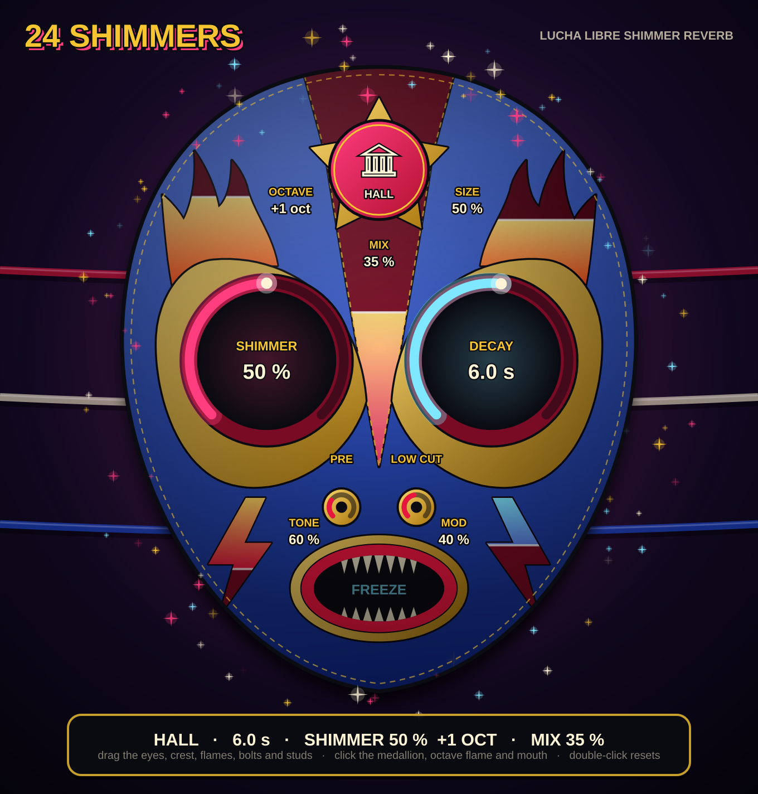

# 24 Shimmers

A lucha libre shimmer reverb for macOS (VST3 + Audio Unit), built with JUCE.



Inspired by the Strymon BigSky shimmer: a lush reverb whose tail keeps climbing
in pitch. The reverb has three spaces (room, hall, cathedral), each with its own
early reflections, diffusion and size. The octave shifter sits in a feedback loop
around the reverb, so each pass adds another octave on top.

## The mask is the interface

Every control is a feature of the mask. Hover any feature and the banner at the
bottom shows its name and value.

| Feature | Control | How |
|---|---|---|
| Forehead medallion | **Space**: Room / Hall / Cathedral | click to cycle (shift-click goes back) |
| Left eye | **Shimmer**: how much octave-shifted sound feeds back | drag up/down |
| Right eye | **Decay**: 0.3 s to 60 s | drag |
| Crest (centre stripe) | **Mix**: gold fills the crest as it gets wetter | drag |
| Left eyebrow flame | **Octave**: −1, +1 or +2 (the flame grows) | click to cycle |
| Right eyebrow flame | **Size** of the space | drag |
| Left cheek bolt | **Tone**: how fast the highs die away | drag |
| Right cheek bolt | **Mod**: slow movement in the tail | drag |
| Left nose stud | **Pre-delay**: up to 500 ms | drag |
| Right nose stud | **Low cut** | drag |
| Mouth | **Freeze**: holds the tail forever | click |

Hold shift while dragging for fine control. Double-click a feature to reset it.

## How it works

```
input -> pre-delay -+-> early reflections ----------------------------+--> wet
                    |                                                 |
                    +--> diffuser (8 ch) --> late reverb (16 lines) --+
                              ^                          |
                              +----- octave shifter <----+   (shimmer loop)
```

- **Early reflections:** a different pattern for each space, scaled by Size.
- **Diffuser:** four to five mixing stages turn the input into a dense wash
  before the tail starts. This is what removes the metallic edge.
- **Late reverb:** a 16-line feedback network with exponentially spread
  delays, slow wandering modulation, and highs that decay faster than lows.
- **Shimmer:** a smooth three-grain octave shifter that takes the reverb
  output and feeds it back through the diffuser. The loop gain is capped, so
  even 100% shimmer always dies away in the end.

## Getting the plugin

Every push to `main` builds the plugin on GitHub's macOS servers as a universal
binary that runs on Apple Silicon and Intel.

1. Open the repository's **Actions** tab, click the latest green
   **Build macOS plugin** run, and download **24-Shimmers-mac** at the bottom.
   You can also push a tag such as `v0.1.0` to get the zip attached to a GitHub
   Release.
2. Unzip it (it contains `24-Shimmers-mac.zip`; unzip that too).
3. Right-click `install.command` and choose **Open**, or follow `INSTALL.txt`.
4. In Ableton Live, go to **Settings → Plug-Ins**, enable *Use VST3 Plug-In
   System Folders* and/or *Use Audio Units*, then **Rescan**. The plugin
   appears under **Plug-Ins → Thiel → 24 Shimmers**.

The plugin is ad-hoc signed rather than signed with a paid Apple Developer ID.
That's fine for your own Mac; the installer removes the download quarantine.

## Building locally

You need Xcode (or the Command Line Tools) and CMake. JUCE is downloaded
automatically.

```bash
cmake -B build -DCMAKE_BUILD_TYPE=Release
cmake --build build --config Release -j 8
./build/EngineTest
```

The plugins end up in `build/TwentyFourShimmers_artefacts/Release/`. There is
also a Standalone app there for trying the plugin without a DAW.

## Layout

```
Source/ShimmerEngine.h      DSP: early reflections, diffuser, 16-line FDN, octave shimmer loop (plain C++)
Source/PluginProcessor.*    JUCE wrapper and parameters (Parameters.h)
Source/PluginEditor.*       UI: mask hit areas wired to parameters, banner, sparkles
Source/MaskArt.*            Mask artwork: every feature drawn from its parameter value
Source/LuchaStyle.*         Colours and text helpers
tests/EngineTest.cpp        Offline DSP checks (decay, loudness, echo density, octaves, freeze, stability, CPU)
tests/UISnapshot.cpp        Renders the UI to PNG and checks every feature is clickable (-DSHIMMER_BUILD_SNAPSHOT=ON)
```
